<br/>

<div align="center">

[](https://clayza.is-a.dev)
[](https://maelyn.my.id)
[](https://maelyn.sbs)
[](https://cashify.my.id)

</div>

<br/>

## `> about`

A wanderer who builds whatever sparks curiosity: REST APIs, bots, scrapers, Android apps.
Lately I'm also fine-tuning existing AI models and seeing how far a small dataset can take them.

```text
build  →  break  →  learn  →  repeat
```

## `> stack`


## `> ai.lab`

Taking pre-trained models and teaching them new tricks: dataset prep, LoRA / fine-tuning, evaluation, and shipping the result behind an API.



## `> projects`

| | |
|:--|:--|
| [**Casaku**](https://casaku.id) | QRIS automation helper. Turns static QRIS into dynamic transaction flows. Not a payment gateway. |
| [**Maelyn API**](https://maelyn.sbs) | REST API for misc tools. Built to be used, extended, and occasionally broken. |
| [**Maelyn Group**](https://maelyn.my.id) | Hub for my experiments and side projects. |
| [**Portfolio**](https://clayza.is-a.dev) | Profile, links, and the story so far. |

<br/>


